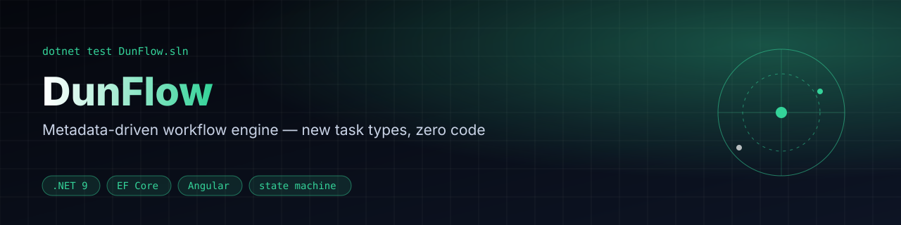
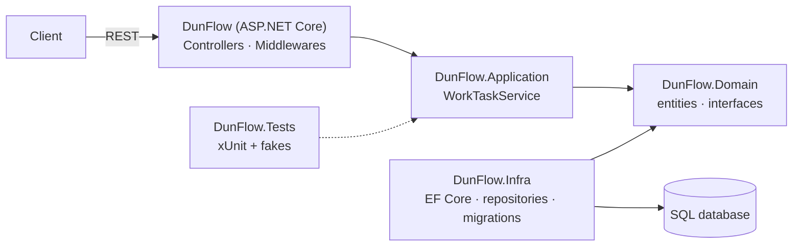

<div align="center">



[](https://github.com/Shtibel1/DunFlow/actions/workflows/ci.yml)


**A task-management API where workflows are data: task types, status transitions and required fields live in the database, not in code.**

</div>

## Features

| | |
| --- | --- |
| **Metadata-driven workflows** | `WorkTaskTypes`, `WorkTaskStatuses` and `FormFields` define every workflow — no per-type `if/else`. |
| **Validated state machine** | Sequential forward moves, backward moves to any earlier status, close only at an `IsFinal` status. |
| **Per-status required fields** | Each target status enforces its own form schema; missing values are rejected with the field label. |
| **Dynamic UI contract** | `WorkTaskMetadataController` exposes the same metadata so a client can render the forms. |
| **Clean layering** | API → Application → Domain ← Infra (EF Core), with a test suite on in-memory fakes. |

## Architecture




## Extensibility Strategy (How to add a new task type)
One of the core design goals was to avoid hardcoded conditional logic for different task types.
To achieve this, I implemented a **"Metadata-Driven Workflow Engine."**

All rules regarding task states and required data are defined in the database via the following tables:
- `WorkTaskTypes`: Defines the overarching task categories (e.g., Development, Procurement).
- `WorkTaskStatuses`: Defines the valid sequential statuses for a given `WorkTaskType`.
- `FormFields`: Maps specific required data fields to a specific `WorkTaskStatus`.

### Adding a 3rd Task Type
To add a new task type (e.g., "HR Onboarding") without touching existing backend C# code:
1. **Insert a row into `WorkTaskTypes`:** 
   `(Id = 3, Name = 'HR Onboarding')`
2. **Insert rows into `WorkTaskStatuses`:** 
   Define the sequential steps, e.g., 
   - `(WorkTaskTypeId = 3, StatusValue = 1, DisplayName = 'Created', IsFinal = false)`
   - `(WorkTaskTypeId = 3, StatusValue = 2, DisplayName = 'Documents Collected', IsFinal = false)`
   - `(WorkTaskTypeId = 3, StatusValue = 3, DisplayName = 'Onboarding Complete', IsFinal = true)`
3. **Insert rows into `FormFields`:** 
   Define the required data for those statuses, e.g., for StatusValue 2, require "TaxFormLink" and "IDScanLink".

The server will automatically fetch these rules and validate state transitions.
The Angular client dynamically generates UI input fields based on the same metadata.

## Quick start

### Backend (Server)
1. Navigate to the DunFlow directory:
2. Ensure you have the .NET SDK installed (.NET 9).
3. Restore dependencies: `dotnet restore`
4. Update your database with Entity Framework Core migrations (which includes the seed data). Be sure to configure the connection string in `appsettings.json`.
   `update-database`
5. Run the application:
   The backend API will typically be available at `https://localhost:7176`.

## Tests

The workflow rules live in `WorkTaskService` and are covered by an xUnit suite in `DunFlow/DunFlow.Tests`, which runs against in-memory fakes (no database needed):

- Forward moves must be sequential, while backward moves to any earlier status are allowed.
- Each target status enforces its own required `FormFields`, and a missing or blank value is rejected with the field's label.
- Custom field data is merged across transitions, and newer values win.
- A task can be closed only at a status marked `IsFinal`, and only once.

Run them from the `DunFlow` directory:

```bash
dotnet test DunFlow.sln
```

GitHub Actions builds the solution and runs the suite on every push and pull request.

## Roadmap

- [ ] Transition history / audit log per task
- [ ] Role-based permissions per status
- [ ] Docker Compose for API + database
- [ ] OpenAPI-generated client for the front end
